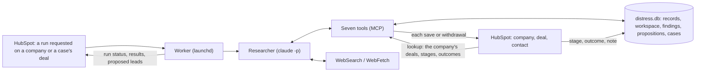

# distress-signals specification

This file is the reference for the code. When the code and this file disagree, change one of them in the
same commit. `docs/model.md` states the model the code implements: propositions and their links, the case, its
worlds and figures, the bases, and the seam with event-risk. Read it first.

## 1. What it does

distress-signals establishes how a company's revenue depends on an upcoming event outside its control: how
the event reaches the business, and what the revenue would be over a stated period in each way the event can
turn out. The figures are used while the event is open: weighted by each outcome's probability, compared
across companies, set against protection that pays in an outcome, and put to the people who run the
company's finances. The operator works from them in HubSpot.

For a company and an event, a case states:

| | |
|---|---|
| Condition | What has to happen for the company's revenue to be affected: the worlds in which it differs from the baseline, in the propositions' words |
| Dependency | How the event reaches the revenue |
| Timing | When an outcome's effect reaches the revenue |
| Exposure | How much of the business is exposed: the revenue at stake in each of those worlds over a stated period, measured from the baseline, from evidence, with the basis for every estimate |
| Person | Who is responsible for the affected business or the company's finances, as a record names them |

Research that isn't a case, or explains one, is kept as findings. A case whose reason for contact goes
away is withdrawn from the active queue, with the finding that says why.

The analyst owns the judgment; code reads records, checks quotations, reads observed figures from saved
results, and computes every result.

HubSpot is where the operator works. A run is requested on a HubSpot record, and each case arrives there
as a deal as soon as it is saved, with its company, its person and its memo. The run's status and results
are written back to the record that asked. Conversation outcomes come back onto the cases. The terminal
is for setup and maintenance.



## 2. Principles

- **The analyst owns the judgment; code observes and computes.** The analyst chooses the companies, the
  events, the sources and the financial model, and states its reasoning where judgment enters. The store
  keeps what it reads, runs its queries, checks quoted passages, reads an observed figure from the cell of a
  saved result, and calculates the results from the inputs and the formula.
- **Basis.** Every figure is observed in words (a passage), observed by query (a cell of a saved result, which
  the store reads), assumed (with the reasoning, and the passages and results it rests on), or calculated.
  A passage is the relevant section of text, checked word for word against the stored record. The section is the sentence that states the figure, or its line item with the
  table's heading, never the number alone. Saving refuses any cited passage of fewer than three words. Once a
  passage is found in the record, what is stored and shown is the whole of the sentences it falls in (sentencex),
  whatever span the analyst quoted; where lines run without sentence punctuation, as table and form rows do, the
  whole of its lines.
- **The assignment is what the operator gives.** The analyst is told what the work is and how the store works
  (`config/system.md`) and what each tool does. A run's prompt is its assignment: an open search, or a
  subject or brief the operator selects, or the case to refresh. Prior research is retrievable by ID or
  name with `lookup`, and isn't handed to the analyst, or listable by it, as a place to start: the
  workspace holds only what the current run has read and recorded. Worked examples,
  seed companies, suggested sectors and directions from earlier runs stay out of its instructions.
- **Everything inspectable.** Each run keeps its assignment as given, every event of the session with
  reasoning summaries, and its tool-call log; each case keeps every revision.
- **Build what the product uses.**

## 3. Records

SQLite at `distress.db` (gitignored): WAL mode, a 5-second busy timeout, one connection per tool call,
short write transactions. Shapes are declared once in `models.py` and reused by the tool schemas, the
store and the exports. `db.py` holds the schema and adds columns when the schema grows.

### Identity

| Record | ID | Key |
|---|---|---|
| Company | `co_` + hash | Normalized domain; without one, the normalized name |
| Proposition | Its key | Chosen by the analyst, unique in the store |
| Case | `case_` + hash | Company + events + revenue-stream key |
| Observation | `obs_` + hash | Source and native ID, or the address |
| Finding | `fnd_` + hash | Its kind, statement, subject and time |
| Workspace result | `wk_` + hash | Its name and query |

- A company given with its `id` edits that company; an old name stays as an alias. Without an `id`, a
  company matches by domain, else by the one saved company with the same normalized name or alias.
  Several matches are an error that asks for the domain or ID.
- A save with `case_id` keeps that case's company, events and stream key; a different combination is a
  different case.
- `lookup` returns a case in exactly the form `save_case` accepts.

### Propositions

Every claim is a proposition (`docs/model.md` section 2): an event, a way an event or another claim can turn
out, and what a company or the parties around it do once an outcome is known. One shape, `models.Proposition`.

| Field | Meaning |
|---|---|
| `key` | A short identifier, unique in the store; it stays the same when the wording is revised |
| `side` | On a way of a proposition that is not itself a way: the side it divides, `yes` where left out |
| `title`, `text` | The claim in a few words, and in full: what would make it true |
| `kind` | `scheduled_decision` (a decision scheduled on `window_end`), `hitting` (true where it happens at any time through `window_end`) or `level_at_date` (a level on `window_end`) |
| `window_start`, `window_end` | The window; `window_end` is the date it is decided on or by |
| `comparison` | `occurs`, or for a claim about a level one of `>`, `>=`, `<`, `<=`, `==` |
| `metric`, `unit`, `value`, `upper_comparison`, `upper_value` | For a claim about a level: the quantity, its unit, the threshold, and a band's upper end |
| `resolution_source` | Where a record will show how it turned out, that record |
| `description`, `timing` | Who or what decides it and how; the steps to `window_end`, each with its date and how firm it is |
| `evidence` | Passages that establish what the claim is, when it is decided, and what bears on how it turns out |
| `implies`, `implies_not` | Keys of the propositions that are true, or false, wherever this one is true |
| `ways` | The ways it can turn out, each a proposition in full, nested |

**Stated in full.** A proposition is given in full, its ways nested in it, in the `propositions` of the call
that introduces or revises it (`save_case`, `calculate_exposure`, `record_finding`). It takes the place of the
saved one with the same key, its ways with it. The store keeps one row for each proposition, with the key of
the proposition it is a way of and the side it divides (`worlds.flatten`, `worlds.nest`).

**What a statement of a proposition must keep.**
- A key names one proposition: a key that already names a proposition elsewhere is refused.
- A proposition has no ways on a side, or at least two.
- Level fields are compared between two propositions on one metric, in one unit, with one resolution source,
  decided the same way over the same window (`worlds.comparable`). The ways beside one another cannot both be
  true by them, and a way's values lie within those of what it divides, or apart from them on its No side. Where
  the ways' thresholds leave values in none of them, the save says which and stands.
- Every proposition an active case reads stays, and so does every proposition another is linked to.
- Where a call states or removes a proposition, every other active case is computed again on the propositions
  as they then stand. One left without its figures refuses the statement, naming the case. One whose
  propositions or figures differ gets a revision of its own, cites what its propositions now cite, and is
  delivered again.

### The case

| Field | Meaning |
|---|---|
| `company` | The company, in full or by saved ID |
| `events` | The key of the event the case is about; two keys where two events are read together on one stream |
| `stream_key`, `stream` | A short identifier for the affected revenue stream, and the stream in words |
| `dependency` | Why the company earns less in those worlds |
| `timing` | When the company would feel the effect |
| `period` | The span over which revenue is counted |
| `currency` | The currency of the revenue figures |
| `revenue` | The formula for the revenue recognized within the period. At the inputs' values it gives the baseline; at their values in a world, the revenue there |
| `contribution`, `deferred_past_period`, `cash_delayed` | Formulas over the same inputs, where they apply: revenue less the costs that change with it; revenue recognized after the period instead of within it; cash collected later than it otherwise would be |
| `inputs` | The drivers of the revenue, by name, each at its value over the period as things stand, with a unit and its basis in two parts, one or both: where the figure is read, `source` (a quoted passage) or `result` (the cell of a saved compute result: its `result_id`, `column`, and the `row` columns and values that pick out one row; the store reads the value); and the `assumption` by which it holds for the input (a `note` with the reasoning, and the `evidence` passages and `results` it rests on) |
| `given_values` | Each: `given`, the keys of the propositions that are true; `given_not`, those that are false; and `values`, the inputs that take another value there, each with its `value` and the same basis in two parts |
| `denominator` | What the shortfall is a share of |
| `person` | The person responsible for the affected business or the company's finances: their responsibility, name, title, and the record that names them |
| `evidence` | Passages that establish the dependency and the timing |
| `change_note` | What a save changed |

A case is `active` or `withdrawn`. `record_finding` with `withdraw_case` withdraws it; saving it again
returns it to the active queue. A withdrawn case reads as its last revision held it, with the propositions as
they stood then.

**Worlds and figures** (`docs/model.md` section 4; `worlds.py`, `exposure.py`).
- A case reads its events, every proposition its given values name, and with each way so named the ways beside
  it and the ways it lies within, up to its event. An event is a proposition that is not a way.
- Its worlds are the combinations of those propositions being true or false that the links allow: a way is
  true only where what it divides is true, exactly one of the ways beside one another is true there, an
  `implies` or `implies_not` link holds, and so do the relations code reads from level fields. Links are followed
  through propositions the case does not read.
- In each world an input takes the value of the one given value that holds there, sets it, and has its worlds
  strictly within those of every other that holds there and sets it. An input none sets stands at its own value.
- A given value whose condition holds in no world is refused. So is a world where several given values set one
  input and none is the most specific, naming the world, the input and the given values.
- The store reads each figure given a `result`, on an input or a given value, from its cell. A row that picks out no row or several is refused, and so
  is a value given with it that differs from the cell's.
- Each passage under an assumption is checked in its record as any cited passage is, and each result it rests
  on is one that is saved.
- The case's condition is the worlds whose revenue differs from the baseline's, in the propositions' words: the
  save, `lookup`, the memo and the deal all show it.

### Findings

A finding is a `fact` (with the passage that states it), an `inference` or `conclusion` (with the
passages or workspace results it rests on), a `question`, or something `dropped` (a company, dependency
or lead set aside). It can concern a company, a proposition or a case, and can replace an earlier finding.

### Tables

| Table | Holds |
|---|---|
| `companies`, `company_keys` | Companies, and each normalized name and alias |
| `propositions` | One row for each proposition: its key, the key of the proposition it is a way of, the side it divides, its place among the ways beside it, and its other fields |
| `cases` | Cases: company, events, stream, status, key date, largest shortfall, the case and results, progress, revision. Cases are listed by largest shortfall |
| `case_reads` | The propositions each case reads |
| `revisions` | Each saved snapshot (the company, the case, the propositions it reads and its results), its hash, change note and run |
| `observations` | Each record read: kind, source, native ID, address, dates, text, data |
| `citations` | Which records each case cites |
| One table for each series, named for it | The records read, a column for each of the series' fields ([section 6](#6-sources)) |
| `findings`, `workspace_results` | Findings; saved workspace queries and their rows |
| `runs`, `run_reads`, `leads`, `deliveries` | Runs with their assignment as given and the order their catalog listed the series in; what each run read; follow-on leads; delivery state |

Amounts keep their meaning: a payment, an obligation, an outlay, reported revenue and a modeled shortfall
are different kinds.

### Results on read

Every read of a saved case goes through `forms.py`: `lookup`, a refresh, delivery to HubSpot, the run page
and the export. An active case's results are computed again from what it states and from the propositions as
they now stand; a withdrawn case's, from the propositions as its last revision held them (`forms.read`).

### What a run can see

`run_reads` records each observation a run reads, whether fetched or reused from the store. Each `compute`
call runs on an in-memory copy holding that run's observations and their record rows, and its own findings
and workspace results; saved cases, companies, propositions and earlier runs' research are not in it.
`lookup` returns a record by ID, a company by its name, alias or domain, and a proposition by its key or
title; it doesn't search by topic. The tool descriptions say what each tool does, without presuming
earlier work; the lookup tool is named `lookup` because the analyst read its earlier name, `get_context`, as
an invitation to load prior research before starting. A run that reaches a
saved company or proposition through its own research finds what is saved about it.

## 4. The researcher

### Runs

| Command | Assignment |
|---|---|
| `research` | An open search |
| `research --company NAME` | That company; the run's cases are for it (save refuses others), and what it learns about other companies becomes findings and leads |
| `research --event TEXT`, `--source URL`, `--lead ID` | That event, source or saved lead |
| `research --brief FILE` | The brief's text; a brief is used only when selected |
| `refresh CASE_ID` | The case, attached as it now stands: read its sources again, revise it or withdraw it |

`--question` adds an operator's note to any run. `--workers` runs several company assignments in
parallel.

### What the analyst is told

The system prompt is `config/system.md` (`agent.system`), the same in every session but for the role its first
sentence names (`agent.ROLE`, an underwriter and a forensic accountant, in the order the work runs; `AGENT_ROLE`
gives another for a trial).

**It holds what the analyst would not otherwise know, and leaves the rest to the role.** A practitioner in that
role already understands what revenue depends on, what is material, what evidence supports, when work is
finished. A sentence that states one of these does harm: the analyst takes the sentence, with its authority, in
place of its own understanding, because following a stated rule costs less than reasoning, and the sentence is
always narrower than the understanding it replaces. An absolute makes it worse, since an absolute is cheaper
still to follow. So the prompt states the work in a sentence and then the things particular to this system:

| Part | Holds |
|---|---|
| Opening | The role. The work, in one sentence. That the store keeps cases and computes their figures, and that probabilities are assessed separately |
| A case | Propositions, and that they are shared; ways, and a proposition that implies an outcome; the model; the period, set apart from a proposition's window; worlds and how an input takes its value in each; the figures; an illustration with placeholders, which a test computes; a figure's basis in two parts |
| The store and the tools | What a save that goes through means, and what it returns; earlier work in the store and `lookup`; what WebSearch and WebFetch return, and that quotations are checked against what `read_record` stored |

Each of these is stated as what it is or what it does. Where a run goes wrong in a way the analyst's own
understanding would have prevented, the cause is in its environment (what a tool makes cheap, what the store
accepts or returns), and the repair is made there, not in a sentence.

It names no company, event or series of records: the catalog in the `search_records` description is the whole of
what the analyst is told about the series ([section 6](#6-sources)), and excluded companies are enforced where a
case or finding is saved. Nothing from earlier runs enters it, and nothing of how the result is used. A field's
description in `models.py` is the definition the analyst reads of that field, and a tool's description says what
the call takes, does, returns and refuses.

Claude Code adds its own parts:
- an identity line, before the system prompt: "You are a Claude agent, built on Anthropic's Claude Agent SDK.";
- the WebSearch, WebFetch and StructuredOutput tool descriptions;
- an environment message with the working directory, the model, its knowledge cutoff and today's date;
- a reminder carrying the signed-in account's email.

The MCP server gives no instructions of its own. The launcher's time limit guards the run and is no part of what
the analyst reads.

### Runtime

`llm.ask` runs `claude -p` in stream-json mode for input and output:

- `--mcp-config` launches `distress_signals.mcp_server`, with its environment given in full (database,
  run ID, log, the HubSpot key as the launcher has it, and for a company run the company the cases are limited
  to), because Claude passes stdio
  servers only a minimal environment. `--strict-mcp-config` keeps other servers out.
- `--tools WebSearch,WebFetch`, and `--allowedTools` listing those and the seven tools.
- The model from `AGENT_MODEL` (default `opus`) and its reasoning effort from `AGENT_EFFORT` (default `xhigh`),
  passed as `--effort`, as the event-risk and scenario-ledger analysts set it. Runs left at the CLI's default
  effort reasoned little and stopped short. The model thinks adaptively. `--timeout` in minutes: 180 for
  `research`, 60 for `refresh`. A run stopped at its limit loses its final answer, though its saved cases remain.
  `MCP_TOOL_TIMEOUT` of 10 minutes, and `CLAUDE_CODE_MAX_MCP_DESCRIPTION_LENGTH` so the catalog of series
  arrives whole (section 6).
- Before the prompt, a `set_max_thinking_tokens` control request sets `thinking_display` to `summarized`,
  so reasoning summaries are returned.

### Transcripts

Each run keeps, under `out/runs/`, `<run_id>.assignment.md` (the system prompt and prompt as given, also
stored on the run), `<run_id>.jsonl` (every event as it arrives), `<run_id>.log` (each call to the seven
tools, with timing and outcome) and `<run_id>.md` (readable: the assignment, then each step's reasoning
summary, text, tool calls and shortened results). `transcript RUN_ID` renders the readable page again,
mid-run too. Each revision is stamped with its run.

## 5. Tools

| Tool | What it does |
|---|---|
| `search_records(series, query, filters, limit, cursor)` | Searches one [series of public records](#6-sources) and returns each record's fields, address and `record_id`, a `cursor` where the search has not reached its end, and a `result_set` ID for every record the search matches. Nothing is stored until it is read |
| `read_record(id_or_url, find, offset, fresh)` | Reads a record by its `record_id`, every record of a `result_set` (up to 25,000), a web page or a PDF. Stores what it read, fills the series' table, and returns the text in 12,000-character segments with the document's links. `find` returns passages around a term. `fresh` reads the source again and updates the same observation |
| `compute(sql, save_as, note)` | Runs one read-only SQL query over the records this run has read (each series' table, and the views of dates, names and amounts across series) and the findings and results it has recorded; returns up to 200 rows; `save_as` keeps up to 2,000 under an ID that inputs and findings cite |
| `record_finding(finding, propositions)` | Records a fact, inference, conclusion, question or dropped lead, about a company, a proposition or a case; can withdraw a case, which updates its deal in HubSpot at once |
| `lookup(id_or_query)` | Returns a saved case (editable form, status, company, the propositions it reads, condition, worlds and figures, cited passages with their sources, findings, recent revisions, and its deal's stage and conversation outcome), finding or workspace result by ID; a company by ID, name, alias or domain, with its deals in HubSpot (the operator's own included), their stages and conversation outcomes; a proposition by key or title, in full with its ways and links, what its level fields say, and each case that reads it: the case's period, formula, baseline, given values and worlds |
| `calculate_exposure(case, propositions)` | Calculates each world's figures from a draft of a case's model without saving: the events, the formula, the inputs and the given values |
| `save_case(case, propositions)` | Saves a case: saves the propositions given in full with it, checks each basis, computes its worlds and their figures, saves the company and the case, writes a revision when the content changed, and delivers the case to HubSpot at once, with each other case a restated proposition moved; refuses an excluded company, or another company in a company run |

WebSearch searches the web and WebFetch reads a page without storing it. A passage can be cited only
from a record read with `read_record`; a page that can't be read that way may be cited by address with its
passage, stored and marked unchecked.

The run's final answer lists the cases saved or revised, a summary (who is worth contacting, what revenue
depends on the outcome, why the conversation is timely, and what was set aside), and follow-on leads. The
launcher stores the leads, and a lead that names a company becomes that company in HubSpot, proposed.

## 6. Sources

**A series is one kind of record**: every Federal Register document, every WARN notice, every federal award.
It is named in its publisher's terms. Where saying what one record is takes an "or", there are two series.
The same kind of record from several governments is one series, and those governments are its jurisdiction.
[`docs/data-sources.md`](docs/data-sources.md) lists the series, how each is reached, and the keys some need.

**The registry** (`sources/__init__.py`). A module in `sources/` fetches records and declares its series in
`SERIES`, where its code lives; the registry finds them. Everything else is in the registry, once, for every
series: the catalog, the search grammar, record references, what a read stores, and each series' table.

**An entry** is everything the researcher is told about a series. It describes the records the way archives
and data catalogs do (ISAD(G), DCAT), with the same parts for every series:

| Part | Holds |
|---|---|
| record | What one record is |
| creator | The body that creates the records in doing its work |
| publisher | Who makes them available, shown where that is another body |
| jurisdiction | The governments whose records they are |
| coverage | The first and last dates held |
| fields | The record's data dictionary: each field's name and type |

An entry states what is. It has no part for limits or for what a series lacks, and nothing about how a record
is reached: keys, bulk files and routes around a publisher's blocks stay in the adapter. Coverage and
jurisdictions are read from the publisher's data once a day where it exposes them (`sources.observe`, kept in
`out/series.json`). The rest of an entry is at most 1,000 characters; a longer one fails when its module loads.

**A field's type is how it is searched**, the same way in every series, so the entry is also the interface:

| Type | A filter gives | Key |
|---|---|---|
| name, place, text | Words, each found in the value | `FIELD` |
| identifier | The value itself | `FIELD` |
| listed values | One of them | `FIELD` |
| date | A range | `FIELD_from`, `FIELD_until` |
| amount, number | A range | `FIELD_min`, `FIELD_max` |
| full text | (the query matches it; a read returns it) | |

A field holds one value, or several where its type is in the plural. A series kept by its parent (a filer's
reported figures, a docket's entries) marks the parent's field required.

**What the registry does with a search.** An adapter takes from a search the filters its publisher applies.
Whatever it leaves, the registry applies to the records returned, and keeps asking for pages until it has what
was asked for or 45 seconds have passed. A search that has not reached its end returns a cursor, however the
filtering was done; a cursor is a position, and means the same whatever size the next call asks for. `total`
is the publisher's count where it applied every filter, and `examined` says how many records the registry
checked where it did not. So every field of every series can be searched, whether or not its publisher can.

**References.** A record is `series:id`, and every record a search matches is `series?the search`. Reading
either stores an observation: the record's fields as labeled lines, then its document. A result set is read
whole, up to 25,000 records and seven minutes, with one line for each record.

**Tables.** Each series is a table of the same name with a column for each field, filled by reads. Three
views cross the series and are generated from the field types: `record_dates`, `record_names` and
`record_amounts`, each `(series, record_id, field, value, observation_id)`. Four generic tables for every
series (records, names, dates, amounts) were considered and rejected: that is the entity-attribute-value
design, which makes a record's own fields awkward to query.

**Keys.** A series names the settings it needs (`requires`). One whose key is not set is left out of that
run's catalog, so the catalog lists what the run has.

**The catalog** is the entries, one after another, in the `search_records` description, under the grammar.
The researcher has all of it from the start, and nothing about a series is held back for a later call.
- **Order.** The order is drawn for each run from its run ID (`sources.order`), so no series is always first,
  and the same run always sees the same order. The `series` parameter lists its values in that order too.
  The launcher stores the order with the run (`runs.series_order`) and writes it in the run's assignment
  file. This is an experiment: whether position affects which series a run uses is to be read from a few
  runs.
- **Length.** Claude Code cuts an MCP tool's description at 4,096 characters unless
  `CLAUDE_CODE_MAX_MCP_DESCRIPTION_LENGTH` says otherwise, so the launcher sets it (`pipeline.claude_env`).
  A captured request showed the description arriving whole with it set, and cut without it. With the 52
  series that need no key, the catalog is about 27,000 characters.

**Kept copies.** Where a publisher gives a bulk file, or one page per record, the adapter keeps what it read
under `out/sources/`, and asks the publisher again when its copy has changed or the kept one has aged: SAM.gov's daily file of active
notices and the current Congress's bill status files (each indexed with SQLite full-text search), GovInfo's
descriptive metadata, OIRA's review files and meeting pages, the House's meeting pages, the Supreme Court's
dockets, the Department of War's releases, and BTS's yearly T-100 Domestic Market tables (indexed in SQLite, with each airline's enplanements by airport
summed from them), the FAA's yearly exports of airports' financial reports, which
are downloaded in headless Chromium because CATS has no API.

**Any address.** `sources/web.py` reads HTML or a PDF as text, with the page's links, for `read_record`.
WebSearch and WebFetch reach everything else.

**Checking a series.** `tests/test_series.py` tests the registry offline. `tests/live_series.py` tries a series
against its publisher through the tools: each field of a record, used as a filter, must find that record, and a
continued search must not repeat one.

## 7. Calculation

`exposure.py` calculates the revenue at stake in each world of a case, and `worlds.py` gives the worlds
(section 3). `calculate_exposure`, `save_case` and every read of a saved case run the same function. A formula
is an expression over input names using numbers, `+ - * /`, parentheses, `min()` and `max()`. The baseline is
the revenue formula at the inputs' values. A world's figures are the formulas at the inputs' values there.

| Result | Meaning |
|---|---|
| `reads` | The propositions the case reads |
| `baseline_revenue`, `baseline_contribution` | The revenue formula, and the contribution formula where given, at the inputs' values |
| `condition` | The worlds whose revenue differs from the baseline's, in the propositions' words |
| `world`, `label`, `text` | For each world: the propositions true in it, at their most particular, and those false; and the same in the propositions' titles and texts. The case's events come first and are always named. Each other proposition is named where, with those before it as they stand in the world, it could still have stood either way, so no two worlds read alike |
| `values` | The inputs that take another value in the world |
| `revenue` | What the company would recognize within the period in this world, work or sales made up within the period included |
| `shortfall` | Baseline revenue less this world's: the revenue at stake within the period |
| `share` | The shortfall as a share of the denominator |
| `deferred_past_period` | Revenue recognized after the period instead of within it, where the case gives its formula |
| `lost` | The shortfall less the deferral: given only where the deferral is given, because otherwise later recovery is unknown |
| `contribution_loss` | Baseline contribution less this world's, where the case gives its formula |
| `cash_delayed` | Cash collected later than it otherwise would be, where the case gives its formula; a timing effect, not lost revenue |
| `worst`, `max_shortfall`, `max_share` | The world with the largest shortfall, and that shortfall and share |

Where the evidence establishes a shortfall within the period but leaves later recovery unknown, the case
reports the period shortfall.

## 8. Outputs

HubSpot is the operator's view (§9). Each deal carries the case's memo, rendered from the case in its
current form (`briefs.py`). The memo covers:
- a headline;
- what has to happen (the condition), the propositions the case reads, how the event reaches the revenue,
  and when;
- how much of the business is exposed: the baseline, each world's revenue, shortfall and share, the formulas,
  every input with its basis, and every given value with what it rests on;
- the person responsible;
- the findings and the sources.

Locally, `export CASE_ID` prints a case whole: status, company, propositions, case, results, sources,
findings and revisions. Each run's transcript stays under `out/runs/`.

## 9. HubSpot

HubSpot is the operator's surface. `hubspot.py` writes every record, and the worker (`worker.py`) runs
what is requested there.

**Records.**
- **Company.** Matched by domain, else by name, and created with its name, domain and description. A
  company already in HubSpot is linked, never overwritten.
- **Deal.** One per case, matched by `distress_opportunity_id` (the case's ID) and named "company: stream ·
  event". It carries
  these properties in the "Distress signals" group:
  - the case's fields: `distress_opportunity_id`, `distress_status`, `distress_event`,
    `distress_event_date`, `distress_condition`, `distress_dependency`, `distress_timing`,
    `distress_stream`, `distress_period`, `distress_revenue_at_stake`, `distress_currency`,
    `distress_share` (percent), `distress_share_of` and `distress_person`;
  - the memo and latest revision: `distress_memo`, `distress_revision` and `distress_change_note`;
  - the operator's `distress_outcome` (`exposure_confirmed`, `already_addressed`, `no_exposure`,
    `wrong_contact`, `meeting_booked`, `not_interested`) and `distress_outcome_note`.

  A new deal starts in a "Proposed" stage at the head of the default pipeline. Moving it on, or closing
  it with an outcome, is the operator's review. Delivery never writes the stage or the outcome.
- **Contact.** The case's person: name, title, `distress_role` and `distress_source` (the public source
  that names them). It is linked to the company and the deal. No email is written, and none is ever
  constructed: the operator adds it. A case that names only a role has no contact.

**Delivery.**
- Saving a case delivers it at once, from the save tool. So does withdrawing it with `record_finding`.
  A later revision updates the deal, and HubSpot keeps each property's history.
- `deliveries` keeps each record's HubSpot ID and the hash of what was sent, so an unchanged case isn't
  written again. A withdrawn case that was never delivered is left out, and a deal deleted in HubSpot is
  not recreated.
- A failed delivery never fails the save. The worker delivers changed cases every five minutes when no
  run is going, and `push-hubspot` does the same on demand.

**The researcher reads HubSpot.** `lookup` of a company shows whether it is in HubSpot and its deals
there, the operator's own included, with their stages and outcomes. `lookup` of a case shows its deal's
stage and outcome.

**Runs are requested in HubSpot.**
- **On a company,** "Distress run" asks for one of four runs:
  - "Research this company": that company.
  - "Research the event in the note": the event and the companies whose revenue depends on it, as
    `research --event` runs it.
  - "Run the open search": an open search.
  - "Run the note as a brief".

  "Distress run note" holds a question for the run, the event, or the brief. Runs that aren't about the
  record's own company are requested on any company record the operator keeps for that purpose.
- **On a case's deal,** "Distress run" asks for "Refresh this case", with an optional note.
- **The worker** checks HubSpot every minute and runs one request at a time.
  - It clears the request and sets "Distress run status" to Running. Requests waiting behind it show
    Queued.
  - It writes the run ID as soon as the run has one.
  - When the run ends, it writes Done or Failed, with the finish time, the cost, and a summary: the
    analyst's summary, the cases saved (each a deal) and the follow-on leads.
  - Before it starts or queues a request, it reads the record again, because HubSpot's search can lag a
    change by a few seconds.
  - A run left Running by a worker that stopped is marked Failed when the worker starts.
- **Leads.** A follow-on lead that names a company puts that company in HubSpot with the status "Proposed
  lead" and the reason and sources. Requesting research on it starts a run. A company with a run requested
  or going is left alone.

**Watching a run live.** While a run goes, the feed (`feed.py`) posts to the record that asked for it:
- one note a minute on the record's activity timeline, with the model's reasoning summaries in its own
  words, what it said, and what it did since the last note: searches, records read, figures computed,
  findings, refusals, and each case saved with a link to its deal;
- "Distress run progress", updated each minute with the time, minutes elapsed, tool calls, what it has
  found so far, and what it is doing now.

**Counting results.** Results are counted the same way everywhere they are reported: the progress line,
the run summary, the watch page, the guide and the command line (`util.found_line`, and its twin in the
pages). Each active case is one revenue exposure, and so one deal. Exposures are reported across the
distinct companies they belong to, by company record. A company with two exposed revenue streams is two
exposures at one company: "4 revenue exposures across 3 companies".

The feed reads the run's event stream as it is written. The researcher isn't touched, and nothing enters
its context. The worker starts a feed with each run, and `feed RUN_ID companies|deals RECORD_ID
[--from-now]` attaches one to a run already going. HubSpot shows new notes when the record is reloaded.

**The run page** (`runpage.py`, served by `watch.py`) is for watching a run without reloading, and for
reading one afterwards. Each feed note and the progress field link to it, at
`http://localhost:8790/runs/<run>` on the Mac that runs the worker (`DISTRESS_WATCH_PORT` changes the
port). Each run has one page with addressable sections for reading and replay. Browser history
retains the reader’s position when moving between sections.

- **Overview** (`#overview`) brings the company findings, research activity and other leads together.
  The public open-search guide introduces the prospecting workflow. Operator views retain the run's brief.
- **Company findings** (`#section-findings`) groups revenue streams under their company and event.
  Each stream opens its case. The table shows the largest modeled shortfall, its period and scenario,
  the suggested contact and a link to the source.
- **Research activity** (`#activity`) charts completed searches, source reads, and queries and calculations
  by minute. Playback, speed and seeking work in place. A case marker opens the log at the moment
  that case was saved.
- **Case details** (`#case/<id>`) groups the exposure, event timing, scenarios, model inputs,
  evidence and suggested outreach. The section selector jumps within a case. Previous and Next
  open adjacent cases, and the timestamp opens the research entry where the case was saved.
- **Research log** (`#research`) displays the run's entries in chronological order. Readers can expand
  an entry to read its full text or inspect its searches, documents and calculations. Each saved finding
  appears at its timestamp with a link to the case.
- **Replay** (`#play`) reveals entries and their actions in sequence. The time slider seeks through
  the original run. The 1×, 2× and 4× controls set the playback speed. At 1× the player holds each
  entry's opening text for 1.8–3.4 seconds, a researcher message for 2.2–4.5 seconds, an action for
  0.35 seconds and a saved finding for 3 seconds (`PACE`). Playback keeps earlier entries available.
  Scrolling back lets readers inspect them while playback continues. **Follow replay** returns to
  the current entry.
- `#found/<id>` opens the saved finding in the log. `#step/<n>` opens an individual entry.
  Play resumes at the linked timestamp. Earlier `#research/<chapter>/<page>` bookmarks open
  the first entry that the bookmarked page displayed.
- **Other leads** (`#also`) distinguishes prospects for follow-up from those set aside. Expand a named lead to inspect the reason and available sources.
- During a live run the log polls for new entries and updates pending actions in place. Readers can
  follow new entries or scroll back and select **Latest entry** to return. The replay becomes available
  when the run ends.
- `/` lists the runs. The page reads only the run's event stream and the store.
- `export-run RUN_ID [--public]` writes one run's page as a single self-contained file.
  `--public` leaves out links into HubSpot and keeps the public sources.
- `export-guide RUN_ID` writes the self-contained public run to `index.html`, including an example
  HubSpot deal. `run.html` forwards existing links and their fragments to the same page. GitHub Pages
  serves these files from the `gh-pages` branch.

**Case notes.** Each case's deal gets a timeline note when the case is proposed (with the revenue at
stake), when it reaches a new revision (with what changed), and when it is withdrawn (with why). Each is
posted once.

**Conversation outcomes.** Every five minutes the worker, and `pull-outcomes` on demand, read each deal's stage,
outcome and note onto the case's progress. A change becomes a revision whose change note says what
HubSpot shows.

**Setup.**
- `hubspot-setup` creates the properties on deals, companies and contacts and the Proposed stage. It can be
  run again.
- `HUBSPOT_SERVICE_KEY` needs `crm.objects.companies.read`/`write`, `crm.objects.contacts.read`/`write`,
  `crm.objects.deals.read`/`write`, `crm.schemas.companies.read`/`write`,
  `crm.schemas.contacts.read`/`write` and `crm.schemas.deals.read`/`write`. Tickets aren't available to a
  service key, so requests live on companies and deals.
- `install-worker` runs the worker and the watch page as launchd agents. They start at login, restart if
  they stop, and log to `out/serve.log` and `out/watch.log`.
- A background service has no terminal sign-in, so each run reads its Claude token just before it starts:
  - from the macOS keychain item named in `CLAUDE_TOKEN_KEYCHAIN`, so switching accounts in the keychain
    takes effect on the next run;
  - otherwise from `CLAUDE_CODE_OAUTH_TOKEN`.

  A fixed copy goes stale when the account changes. One did: a run failed on the old account's 5-hour
  limit.

## 10. Commands

Day to day, everything happens in HubSpot. `DISTRESS_DB=FILE` names the store a command uses, and a command
given an empty `HUBSPOT_SERVICE_KEY` writes nothing to HubSpot, its run's tools included. From a terminal:

```
python -m distress_signals hubspot-setup
python -m distress_signals install-worker | uninstall-worker
python -m distress_signals serve
python -m distress_signals feed RUN_ID companies|deals RECORD_ID [--from-now]
python -m distress_signals watch
python -m distress_signals export-run RUN_ID [--public] [--out FILE]
python -m distress_signals export-guide RUN_ID [--out FOLDER]
python -m distress_signals research
python -m distress_signals research --company NAME [--company NAME ...] [--workers N]
python -m distress_signals research --event TEXT | --source URL | --lead LEAD_ID | --brief FILE
python -m distress_signals refresh CASE_ID
    any research or refresh: [--question TEXT] [--model MODEL] [--timeout MINUTES]
python -m distress_signals push-hubspot [CASE_ID ...] [--dry-run]
python -m distress_signals pull-outcomes
python -m distress_signals export CASE_ID
python -m distress_signals leads
python -m distress_signals show ID_OR_QUERY
python -m distress_signals transcript RUN_ID
python -m distress_signals ledgers [--verify]
```

## 11. Removed

| Removed | Why |
|---|---|
| The receivables pipeline (`discover`, `verify`, `collect`, `changes`, `backtest`, `run`, `score.py`, its classifiers, cache and exclusion lists), its samples and docs | The tool prospects on revenue exposure |
| Prediction-market search and reads, protection fields and payouts | As above |
| Event probabilities and probability-weighted results (`expected_loss`, `expected_lost`) | The operator decides whom to contact from the shortfall under each outcome. The probability of each outcome is event-risk's (`docs/model.md` section 8) |
| The requirement that each case model every outcome of a shared event, and the `save_event` tool with its outcome renames | A case gives values for the outcomes that change its revenue. A proposition is saved with a case or finding, and keeps its key when its wording is revised |
| A formula for the baseline and one for each version of the condition, with a name, a description and a timeline for each version | One revenue formula, and the values its inputs take given outcomes. A second figure for an outcome is a second proposition |
| `cash_shifted` | Replaced by revenue made up within the period, `deferred_past_period` and `cash_delayed` |
| The local queue page, CSV and memo files | HubSpot is the operator's view; the memo is on the deal, and `export` prints a case |
| The digest of saved research in every prompt | It handed the analyst earlier cases, rankings and figures as its starting list; prior research is read with `lookup` |
| Clay delivery (company, opportunity and update tables, and its email lookup) | Clay was available only on a trial. HubSpot holds companies, deals and contacts; the operator adds the person's email |
| The operator's offering in the analyst's system prompt | The offering is for writing an opening to the company, which is done after the analysis |
| The opening, the next action, the priority and the reasons to reach out, as fields of a case the analyst states; the mandate that asked for them | The analyst's work is the exposure. A slot for an opening or a next action let a question a record could settle stand as finished work. An opening is written after the analysis, from the saved case. Cases are ordered by their figures |
| A basis of exactly one kind for each figure (`source`, `result` or `assumption`) | A figure read from a record and carried to the case by an assumption has both parts, and the store reads it from its cell |

## 12. File map

| File | Holds |
|---|---|
| `config/system.md` | What the analyst is told in every session: the role, the work, a case, the store and the tools |
| `config/briefs/` | Briefs, each used only when selected. One named `*.local.md` is the operator's own (gitignored) |
| `config/exclude.yaml`, `exclude.local.yaml` | Companies left aside |
| `config/ledgers.yaml`, `config/legistar.yaml` | The payment ledgers; the city and county councils on Legistar |
| `docs/model.md` | The model: propositions and their links, the case, its worlds and figures, the bases, the seam with event-risk, the cases the build passes, and which parts are built |
| `distress_signals/models.py` | Company, proposition, case, input and its basis, given value, finding, observation |
| `distress_signals/worlds.py` | Propositions held flat; what the level fields say; the propositions a case reads, its worlds, and each input's value in each world |
| `distress_signals/db.py` | Schema, migrations, records, workspace tables, findings, revisions, runs, leads |
| `distress_signals/forms.py` | A saved case as it reads now: its figures computed again on the propositions as they stand |
| `distress_signals/tools.py` | The seven tools' functions |
| `distress_signals/mcp_server.py` | The tools over MCP, with their descriptions and the tool-call log |
| `distress_signals/exposure.py` | The calculation |
| `distress_signals/sources/` | The registry of series and the adapters that declare them (section 6) |
| `distress_signals/llm.py` | The Claude CLI call and the transcript |
| `distress_signals/agent.py` | The system prompt and each run's assignment |
| `distress_signals/pipeline.py` | Runs |
| `distress_signals/transcript.py` | Readable transcripts |
| `distress_signals/briefs.py` | Case views: the memo and the export |
| `distress_signals/hubspot.py` | HubSpot: records, delivery, the researcher's view, requests, run status, leads, outcomes |
| `distress_signals/worker.py` | The worker and its launchd service |
| `distress_signals/feed.py` | The live feed of a run into HubSpot |
| `distress_signals/watch.py` | Serves the run page and gathers its data from the event stream and store |
| `distress_signals/runpage.py` | Navigation, case records and research replay |
| `distress_signals/findingsview.py`, `activityview.py` | Grouped findings and the research activity chart |
| `distress_signals/showcase.py` | Public guide export and legacy URL forwarding |
| `distress_signals/names.py`, `util.py` | Name normalization, HTTP, dates, exclusions |
| `distress_signals/__main__.py` | The commands |
| `docs/data-sources.md` | The series, how each is reached, and the keys some need |
| `tests/` | The registry's tests, the model's tests (the cases of `docs/model.md` section 9, and what the store does with propositions and cases), and the harness that tries a series against its publisher |

## 13. Build order

1. **Foundation.** Done.
2. **Tools.** Done.
3. **Researcher.** Done.
4. **Outputs.** Done.
5. **Research runs.** Open searches, briefs when selected, and refreshes and withdrawals as findings
   require. Done when HubSpot holds cases whose condition, exposure and person hold up on review.
6. **HubSpot as the surface.** Delivery on save, the researcher's view of HubSpot, runs requested in HubSpot,
   the worker as a background service. Built.
7. **Docs.** The README and `docs/hubspot.md`: using it from HubSpot.
8. **The model.** `docs/model.md` section 10 lists its parts in order. Propositions in one shape with their
   links, a case's events, model and given values, its worlds and their figures: built. Then, in order: the
   document that crosses to event-risk; changing one value of a saved case, with each figure before and after.
   The whole is then tried on runs on new, unrelated subjects.

## 14. Assignments and briefs

`agent.ASSIGNMENTS` holds the assignment for an open search, a company, an event and a source; a brief is its
own text.

`config/briefs/federal-funding-2026-12.md`, used only with `--brief`:

> Which companies have a material share of revenue at risk from the December 11, 2026 U.S. federal
> funding decision?
